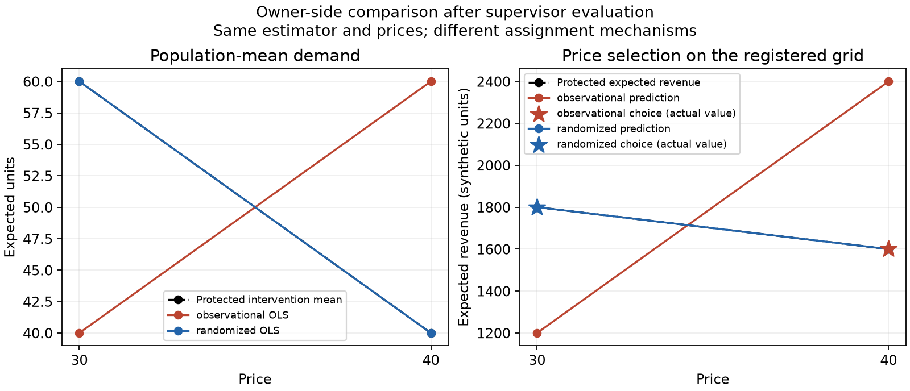

# SciQuest

SciQuest records hypotheses and experiment plans, freezes their inputs, executes
notebooks in isolated processes, and computes validation metrics independently of
the notebook's claims. It preserves research journals, provenance, executed
notebooks, and static dashboards. External agents can propose research actions;
successful execution alone is not scientific confirmation.

## Reproduce a complete research example

**[Pricing under confounding](examples/pricing_confounds/README.md)** is a small,
fully specified scientific example with analytic ground truth. The same OLS
estimator learns the wrong demand slope from confounded observations and the
correct population slope from a balanced randomized design. SciQuest evaluates
both hypotheses against registered intervention means and pricing revenues.

The example supplies the hypotheses, designs, analysis code and commentary in
advance. **It makes zero external-agent calls and does not demonstrate autonomous
discovery.** It demonstrates an inspectable research workflow and a causal-design
pitfall in a deliberately simple synthetic world.



| Training design | Fitted slope | Mean-demand RMSE | Selected price | Expected revenue | Regret |
|---|---:|---:|---:|---:|---:|
| Confounded observations | +2 | 20 | 40 | 1600 | 200 |
| Balanced randomized assignment | −2 | 0 | 30 | 1800 | 0 |

These are exact, noiseless fixture results over the two listed prices, not
estimates of real-market performance or statistical reliability. See the
[executed report and artifacts](docs/examples/pricing-confounds/README.md) and the
[reproduction protocol](examples/pricing_confounds/README.md) for assumptions,
equations, independent arithmetic, limitations, and CI instructions.

Quick start on Linux with CPython 3.12 and working user namespaces:

```bash
git clone https://github.com/eddietaylor/sciquest.git
cd sciquest
sudo apt-get update
sudo apt-get install -y bubblewrap
python3.12 -m venv .venv
. .venv/bin/activate
python -m pip install -r examples/pricing_confounds/requirements.txt
python -m pip install --no-deps -e .
python examples/pricing_confounds/run.py --output ./pricing-run
python -m http.server 8000 --directory ./pricing-run
```

Open `http://localhost:8000/` for the result overview and links to both SciQuest
dashboards. Use a new output directory for each reproduction; existing runs are
never overwritten. CI builds and installs a wheel in a fresh environment, runs
outside the checkout, independently recalculates the metrics, and reproduces
the scientific outputs twice. No model credentials are required.

## Package workflow

Python 3.10+ on Linux is supported for the core package. The pinned example
environment targets CPython 3.12. Bubblewrap and working user namespaces are
required for isolated execution; there is no automatic unsandboxed fallback.

```bash
python -m pip install -e '.[test]'
sciquest --help
sciquest new --method standard_empirical
sciquest new --method strong_inference
sciquest methods list
```

A quest contains `hypotheses.yaml`, `research_contract.yaml`,
`data_manifest.yaml`, `validation.yaml`, `journal.md`, and an experiment directory.
Draft scaffolds are not completed experiments. For a concrete proposal:

```bash
sciquest register --quest demo --experiment exp_001
sciquest execute --quest demo --experiment exp_001 --timeout-seconds 120
sciquest logic-check --quest demo --experiment exp_001
sciquest journal --quest demo
sciquest dashboard --quest demo
```

Commands accept `--root PATH`; quests live under `PATH/quests/`. Registration,
execution and evaluation are recorded by the supervisor. Data, generator replay,
code, metric definitions and method profiles are frozen before execution.
Evaluation labels are excluded from staged features. Workers emit predictions;
the supervisor computes metrics from registered truth. An integrity check audits
the records; it does not certify scientific validity or novelty.

Metrics include MAE, RMSE, WAPE, rank correlation, monotonicity, policy value,
finite-action regret, and constraint violations. Metric roles keep primary scores,
diagnostics and constraints separate. A prediction error, decision value, causal
claim and uncertainty-calibration claim require different evidence.

## External agents and philosophy-inspired policies

SciQuest can launch a configured external worker using `sciquest run-loop` with
an `--agent-command`. A worker prepares a plan/notebook or requests data/stops;
the supervisor executes and evaluates it. Inspect `sciquest run-loop --help`
and the quest's generated worker protocol before connecting a real agent.

Method profiles—including empirical, falsificationist, Bayesian, strong-inference
and other inquiry policies—provide instructions and recorded commitments. Their
presence does not establish faithful philosophical implementation or superiority
of one tradition. The pricing example uses one standard empirical profile and
does not compare philosophies.

The package also contains experimental demand-laboratory and assessment code.
The example does **not** qualify those components, external-agent scientific
reasoning, or the external private-review service. No fabricated agent transcript
or synthetic result is presented as evidence of a genuine agent campaign.

## Development

```bash
python -m pip install -e '.[test]'
python -m pytest tests
```

Core-workflow tests and the dedicated installed-wheel example job run in GitHub
Actions. Scientific assumptions and expected analytic results are intentionally
public, so another researcher can challenge the demonstration instead of treating
a green test as scientific proof.
