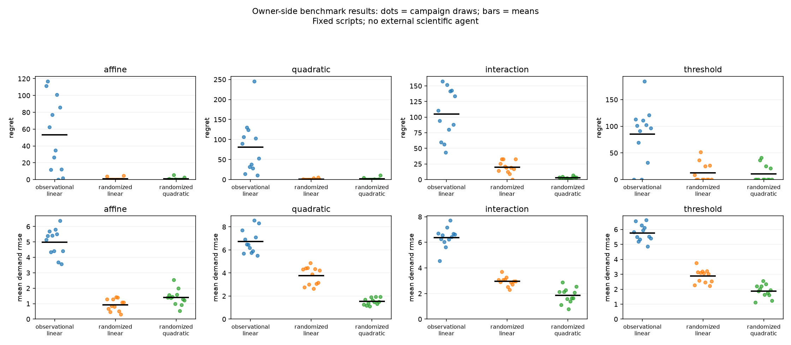

# Executed noisy pricing benchmark v1

This is a separate benchmark from the exact two-price integration control.
The full frozen allocation completed **144/144 isolated estimator executions**:
48 fresh world/data campaigns, four declared response families, three fixed
baselines, 160 noisy training units per design and 64 independent evaluation
contexts over nine candidate prices. Four intermediate prices were absent
from training. No failed, replaced, or retried full-allocation slot; no reporting
errors. **Zero external scientific-agent calls.**

Read the [complete executed report](report.md), [all campaign metrics](metrics.csv),
[machine-readable results and paired summaries](results.json), and
[exact prospective protocol/source](../../../examples/noisy_pricing/README.md).



| World family | Observational linear mean regret | Randomized linear mean regret | Randomized quadratic mean regret |
|---|---:|---:|---:|
| Affine |53.3921|0.7649|0.8072|
| Quadratic |81.1938|0.8450|1.4010|
| Interaction |104.9664|19.6163|2.5766|
| Threshold |85.1023|12.3636|10.3022|

These are descriptive means across 12 world/data draws per family, not a test of
universal superiority. The report includes all paired differences, campaign SD,
MCSE and empirical quantiles, with explicit denominators. In quadratic worlds,
the flexible estimator lowered mean forecast RMSE 3.7679→1.5342 while mean regret
rose 0.8450→1.4010. The paired regret difference is small relative to its MCSE;
there is no statistical superiority claim. Improved forecasts need not improve
a discrete pricing decision.

All 144 fits have **nonzero mean-demand RMSE** (range0.3019–8.5733). Exactly 45
have zero regret, because their imperfect predictions still choose the optimal
listed action in all evaluated contexts. This is retained, not filtered out.
Zero regret is a property of decisions on this finite grid, not perfect prediction.

Oracle means integrate hidden customer type and noise conditional on the visible
context. They remove extra realized-outcome noise from pricing scores **conditional
on the 64 sampled evaluation contexts**; sampling variation in those contexts and
training/world draws remains. The individual-outcome RMSE diagnostic is separate.

## Complete permanent evidence archive

[run.tar.xz](run.tar.xz) contains all 5,781 files of the executed allocation:
all 144 training/evaluation datasets, complete prediction CSVs, fitted coefficients,
source and executed notebooks, logs, journals, dashboards, hidden supervisor
databases and snapshots, frozen source, allocation, registration barrier and
per-file manifest. It is stored in Git, so inspection does not depend on expiring
CI artifacts. [ARCHIVE.sha256](ARCHIVE.sha256) records its checksum.

From a repository checkout with the pinned environment installed:

```bash
(cd docs/examples/noisy-pricing && sha256sum -c ARCHIVE.sha256)
mkdir /tmp/sciquest-noisy-saved-v1
tar -xJf docs/examples/noisy-pricing/run.tar.xz -C /tmp/sciquest-noisy-saved-v1
python /tmp/sciquest-noisy-saved-v1/run/owner_source/audit.py /tmp/sciquest-noisy-saved-v1/run
python -m http.server 8000 --directory /tmp/sciquest-noisy-saved-v1/run
```

Open `http://localhost:8000/` for the saved overview and every SciQuest dashboard.
The frozen auditor does not change evidence or create Python caches. It verifies
5,780 manifest-listed files (the manifest itself is the 5,781st), supervisor
registration/execution/completion bindings, complete action/ID sets, allocation-
assigned models, independent CSV score arithmetic, an alternate augmented
least-squares fit, and paired data/source consistency.

To reproduce, use the [source instructions](../../../examples/noisy_pricing/README.md)
and a fresh output directory. Every scientific results.json/data/prediction row
is expected to reproduce under the pinned environment; timestamps, paths,
notebook execution records and archive bytes can differ. Repeated CI runs are
software reproductions of the same seed allocation, not additional independent
scientific replications.

## Validation and limits

[TESTS.json](validation/TESTS.json) and [final XML](validation/final-tests.xml)
record seven passing tests, including two complete installed-wheel smoke
allocations (24 actual isolated notebooks), adversarial provenance/model/grid
checks, failure continuation and forecast-error/zero-regret counterexamples.
The initial development path-audit failure and subsequent passing development
runs are retained. [Full audit](validation/full-audit.json), [archive restoration audit](validation/ARCHIVE_RESTORE.json),
[execution log](validation/full-execution.log) and [run provenance](validation/FULL_RUN.json)
record the complete local allocation. The original teaching example's 87 saved
artifact hashes were separately verified unchanged.

Critical development reviews cover [simulator/identification](../../reviews/noisy-pricing-v1/simulator.md),
[experimental design](../../reviews/noisy-pricing-v1/design.md) and
[evaluation/argument](../../reviews/noisy-pricing-v1/evaluation.md), with an
[issue ledger](../../reviews/noisy-pricing-v1/issues.json). They include concrete
counterexamples and independent checks of saved evidence; same-model reviewers
are not independent human scientific validation.

This remains four hand-specified synthetic family recipes, with bounded noise,
no costs/capacity/competitors/dynamics and model-dependent intermediate-price
prediction. It does not compare philosophies, demonstrate an external agent's
iterative scientific discovery, or establish real-market validity. Simulator
source/labels/history are excluded from estimator execution; public source cannot
certify that a future external model has no prior training knowledge of it.
